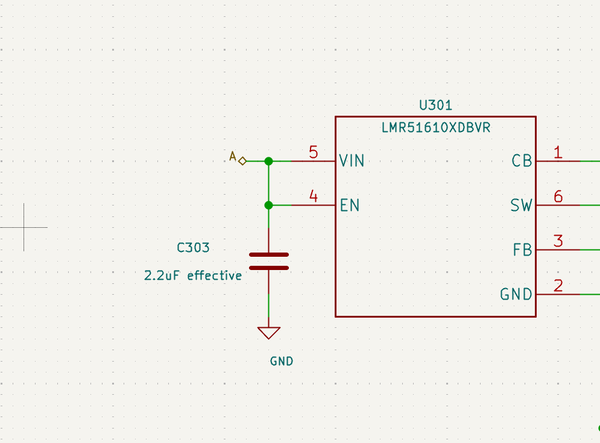
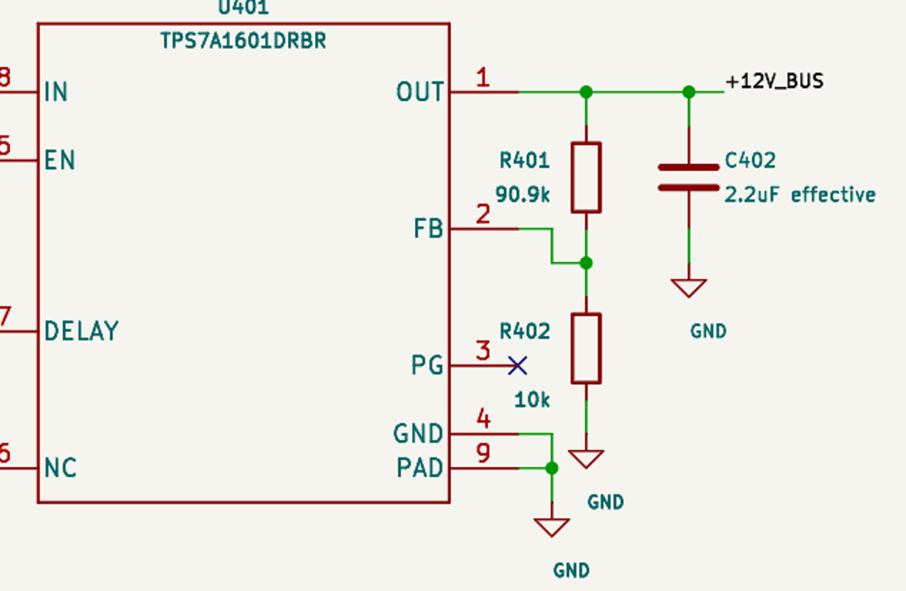
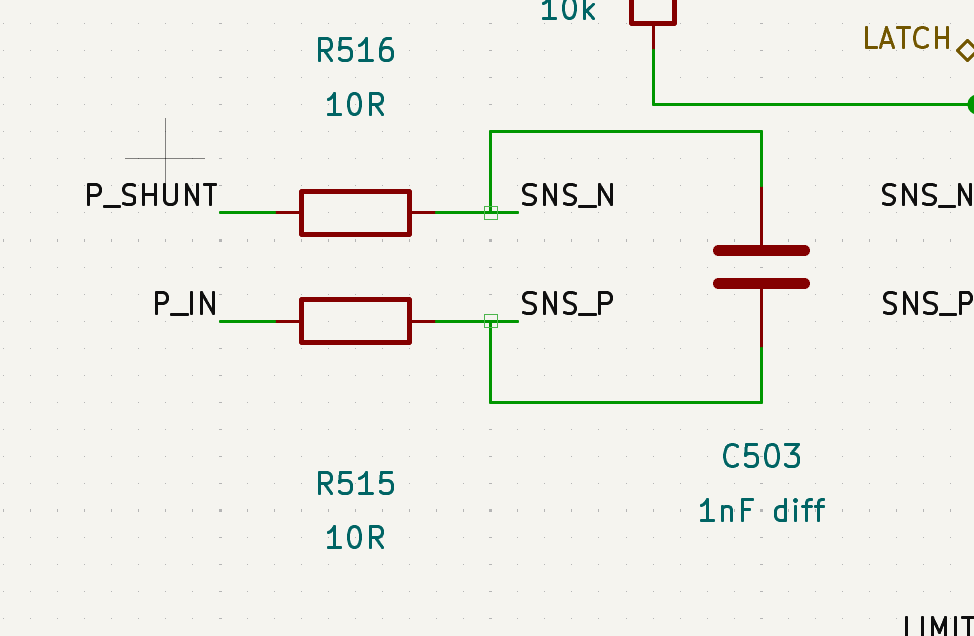
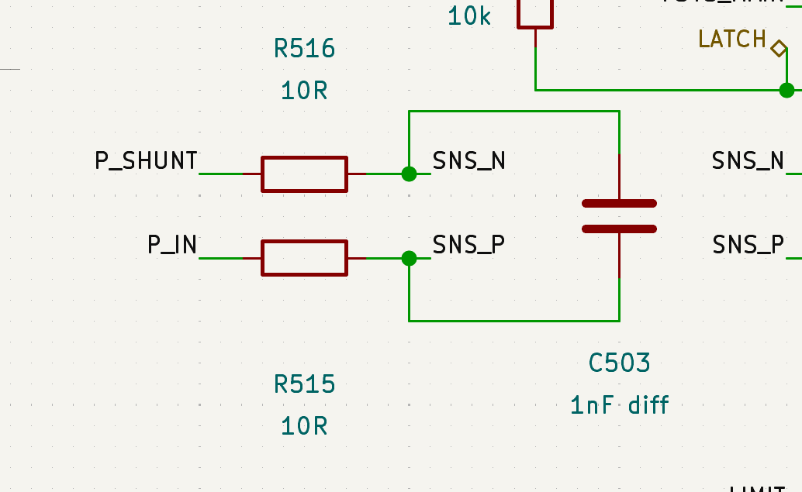
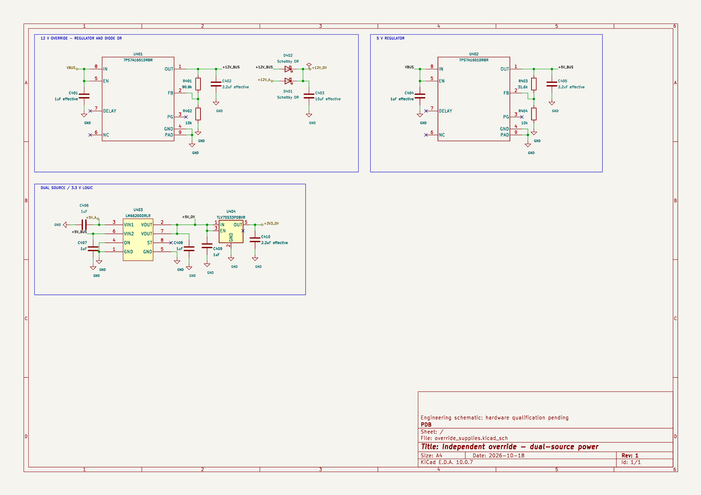

# Approved presentation examples

These examples were developed through user review on a copied PDB project. The named parts explain the examples; they are not part-selection recommendations or mandatory templates for unrelated circuits. Read the relevant images with a local image viewer when comparing layouts.

## Compact input/enable/bypass group — rules 1, 2 and 5

The user replaced a far-left C303 and a large ground-return loop with a capacitor beside/below U301's VIN and EN pins. One nearby vertical rail serves both pins, with GND immediately below the capacitor. Move the support circuit and reshape its wires rather than preserve the old route.

Measured saved example: VIN and EN endpoints each have a 100 mil horizontal lead to the rail. The EN junction to C303's upper pin and C303's lower pin to the GND anchor are also 100 mil. Measure from electrical pin endpoints, not the symbol outline.

## Comfortable passive branch spacing — rules 3 and 4

The user rejected 600 mil between comparable resistor/capacitor branches as unnecessarily wide, then rejected the closest non-overlapping 150/200 mil arrangements as too tight. The accepted revision uses 300 mil between the R401/C402, R403/C405 and C408/C409 centre columns. Fields move to outer free space rather than occupying the narrow gap. The user explicitly accepted this relaxed result.

Use this breathing room for comparable ordinary parallel passive branches. Preserve pin-lead lengths while adjusting the shared rail span. Actual symbol geometry can require a larger pitch; minimum non-overlap alone is not the desired result.

## Long USB CC detours — rule 5

The user accepted replacing two long CC1/CC2 wires that wrapped around the connector/protection circuit with separate matching local net labels. Treat the connector and CC pull-downs as a local group and protection as another. Keep each interface's short pin stubs, then compact each group independently.

In this example the previously unnamed nets became USB_CC1 and USB_CC2. A rename changes the native net text without authorising a different set of connected pins. Verify those complete pin sets independently of names. The accepted principle is grouping and label separation; exact coordinates from the PDB trial are not portable editor instructions.

## Missing junctions despite visual contact — rule 6

In the faulty C503 example the capacitor branch endpoints touch the middle of the resistor/sense wires, but no dots exist. Native KiCad output puts the capacitor pins on separate unconnected nets. The corrected example includes dots at both branch contacts. Require the drawn dots and native net agreement; a before/after comparison that preserves an existing fault does not pass the junction check.

These images demonstrate the intended connection. They do not authorise repairing unrelated existing circuits during a presentation-only task.

## Sheet organisation — accepted circuit-box packing

The accepted override-supplies page has three circuit boxes: 12 V override and 5 V regulator across the first row, then dual-source/3.3 V logic at the left of the second row. Box tops align within each row. The first row is 100 mil below the inner drawing border, each row starts 100 mil from its left edge, and horizontal/row gaps are 200 mil. The row gap is measured below the tallest box of the preceding row. Spare space to the right and bottom stays unused.

Each box fits the visible circuit content with at least 300 mil clearance. Right/bottom padding is 300 mil; top/left padding is approximately 301–341 mil because the smallest necessary allowance keeps complete electrical groups on the 50 mil grid while the outer box placement remains exact. The box heading occupies the upper margin. The same policy was accepted on main supplies. These results explain the grid allowance; 341 mil is not an additional target.

The override example preserved all 55 connected physical pin-lead lengths: 52 at 100 mil, three existing 200 mil exceptions at the regulator OUT and selector VIN2 routes. Whole-project native component records and complete named pin partitions were identical before/after. This sheet had no ERC or junction findings; pre-existing faults on other sheets remained reported. Exact group widths, particular parts and the number of boxes per row belong to this example, not the general rules.

## Step 0: symbol compaction

Read [the accepted U303/U301 symbol comparisons, additional TCAN test and placed-instance completion evidence](symbol-compaction.md) when the entry scan finds a candidate. U303 and U301 illustrate avoidable oversized or uneven geometry; U302 and U304 illustrate reasonable peers to leave unchanged. The subsequent U1402 test covers the complete Steps 0–2 sequence through an updated placed instance and verified A4 sheet. This is a conditional step before connection tidying and sheet organisation, with permission and exception handling before symbol mutations.

## Dimensions that remain example-specific

The opposing MOSFET bank uses a 1250 mil repeat pitch and a 200 mil origin offset to align its rotated source/drain terminals. Those are properties of that arrangement, not additional general spacing rules. No fixed universal text clearance or permission to hide repeated values follows from the examples.
