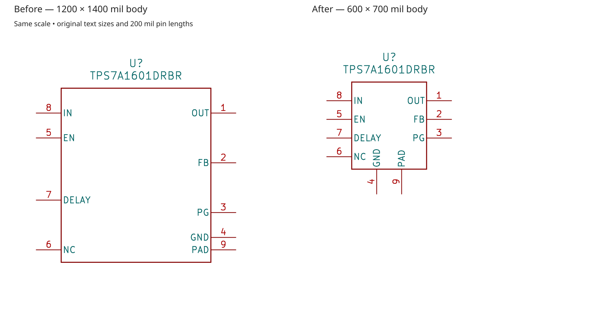
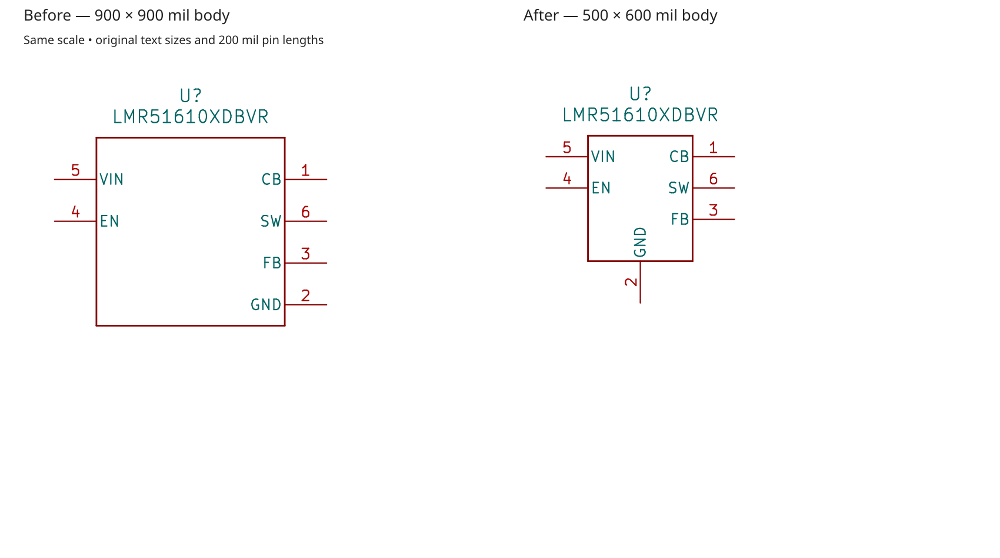
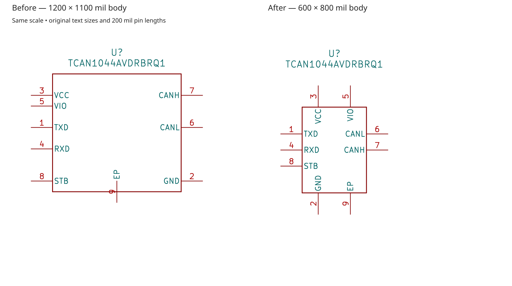
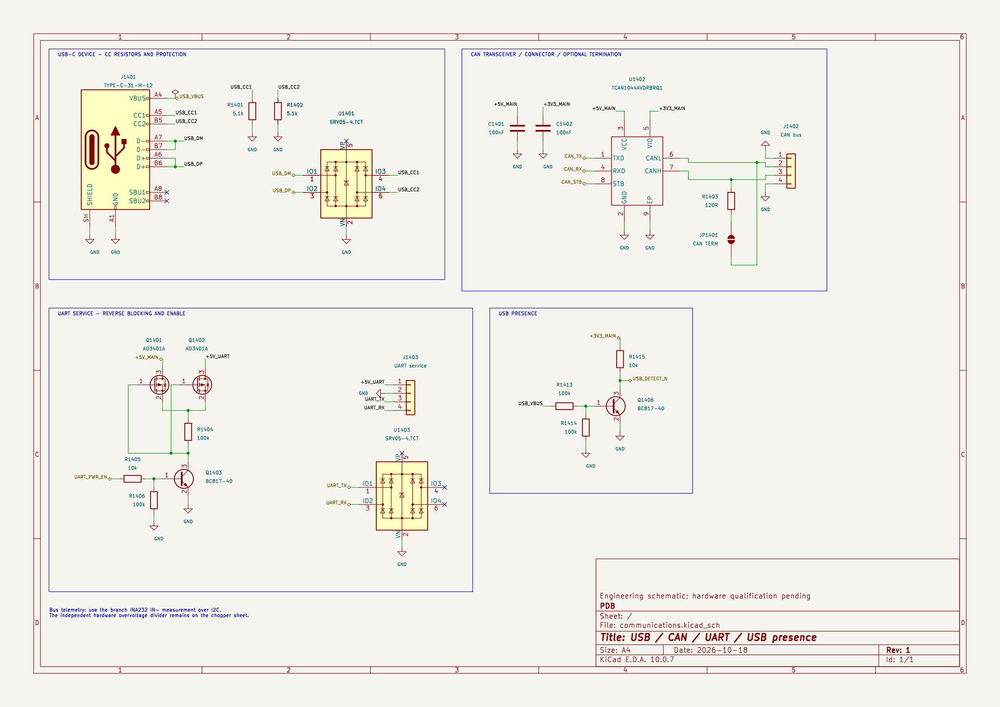

# Step 0: symbol compaction

Read this when the entry scan finds an eligible symbol. Step 0 is conditional, but when performed it ends with the approved changes applied to the placed schematic instances and verified. Step 1 tidies the resulting circuits; Step 2 fits and packs their circuit boxes. Run these in order, rather than doing Steps 1 and 2 before the symbol update and repeating them afterwards.

## Scan and permission

Review actual saved symbol geometry in the requested sheets. Repeated instances of an identical definition need only one eligibility inspection; different cached geometry, units and body styles must be considered. Use pin count, pin-name lengths, functional grouping and routing needs to judge whether empty space, irregular spacing or overall size is avoidable. Explain the specific defect. Do not introduce a maximum size, minimum percentage reduction or mandatory pitch.

The initial scan may stop at its first clear hit. A suitable question is: “This symbol has [specific avoidable geometry]. May I compact eligible schematic symbols and update their placed instances in the requested scope? Are there any components, symbols or libraries to leave unchanged?” Wait for the answer unless existing explicit permission and exceptions already cover the work. Declining symbol changes skips Step 0 and continues with the requested later steps. With permission, inspect the remaining definitions and preserve every exception; the first-hit shortcut does not authorise blind batch changes.

No hit means skip Step 0. A large MCU, deliberate pin-group gap, asymmetric interface or side-mounted ground is not automatically a hit. The goal is to correct outliers, not minimise every symbol.

## Accepted symbol examples

### U303: TPS7A1601

The original nine-pin symbol had a 1200 × 1400 mil body with large unused regions and irregular side-pin gaps. The accepted result has a 600 × 700 mil body: IN/EN/DELAY/NC on the left, OUT/FB/PG on the right, and separate GND/PAD pins below. Side rows use 150 mil pitch. All nine pin identities, electrical types and visibility, existing text sizes and 200 mil drawn-pin lengths are retained. The first bottom-pin placement left NC/GND text too close; a rendered refinement moved the bottom pins inward without changing their identities.

### U301: LMR51610

The six-pin symbol's original 900 × 900 mil body was disproportionately large. The accepted result has a 500 × 600 mil body, VIN/EN on the left, CB/SW/FB on the right and GND below. Adjacent CB/SW pins preserve their bootstrap-capacitor association. Side rows use 150 mil pitch; text sizes and 200 mil drawn-pin lengths remain unchanged. Its placed instance uses a reviewed project-local library, so that definition was updated without replacing its electrical pin types from a different base library.

U302 (LM66200, regular pin spacing and a 500 × 700 mil body) and U304 (TLV75533, a compact functional arrangement) were accepted as reasonable peers to leave alone. U302's longer drawn pins alone were not a reason to compact it. These part numbers, body dimensions and pitches illustrate decisions; they are not eligibility thresholds or required geometries for other symbols.

## Additional applied test: U1402, TCAN1044A

This subsequent test applied the written Step 0 rules to a different nine-pin symbol. Its 1200 × 1100 mil body had large unused regions and irregular spacing. The compacted 600 × 800 mil body groups VCC/VIO above, GND/EP below, logic pins left and CAN bus pins right. CANL is above CANH to match the existing connector's pin order and avoid an unnecessary bus crossover. Pin numbers, names, electrical types, visibility, text sizes and 200 mil drawn-pin lengths remain unchanged. These dimensions are test results, not a numerical eligibility rule.

Step 0 updated the actual local-library definition and placed U1402 instance. Step 1 rebuilt its bypass, logic, bus, optional termination and ground wiring around the new pin positions; a rendered check caught and corrected overlapping fields on the rotated termination jumper. All 76 connected physical pin leads on the sheet measure 100 mil, and comparable passive branches retain 300 mil pitch. Other USB/UART/presence circuits retain their internal geometry.

Step 2 replaced the original oversized custom page with A4 and packed all four existing boxes in two rows, preserving reading order. Independent final native group renders measured internal clearances of 300–348.189 mil; row starts are 100 mil from the inner border and horizontal/row gaps are exactly 200 mil. The title block and engineering note remain clear.

Fresh baseline/candidate/applied native comparisons preserve all 419 physical component records semantically and the exact 286 named pin partitions / 1246 pin nodes. The communications sheet has no ERC or junction findings; four pre-existing ERC findings and two branch-source junction discrepancies affecting twelve channel contacts elsewhere remain unchanged unresolved failures. Only the local TCAN symbol definition and communications sheet changed. This is a worked connectivity/layout test of the authorised path, not a benchmark of automatic candidate selection or electrical qualification.

## Placed-instance completion and verification

The early library previews above were an intermediate review, not completed Step 0. A subsequent isolated-candidate exercise updated U301/U303 and the two other in-scope TPS7A1601 instances, U401/U402. Their attached circuits and NC markers were mapped to the same original pins before the connection and sheet passes. Native verification preserved 419 physical components, all 286 named pin partitions and 1246 pin nodes. Four expected library-mismatch warnings cleared; four pre-existing ERC findings and two shared branch-source junction discrepancies elsewhere remained unresolved. This is connectivity/presentation evidence, not electrical qualification.

Before accepting a Step 0 result:

- Compare every pin's number, name, type, visibility and unit/body-style membership against the baseline; preserve duplicate physical power/ground pins separately. Check the same footprint-pad relationship and instance identities.
- Verify the exact authorised local-library definition is cached in each affected instance. Protect shared-library users outside scope; use a project-local variant rather than updating them implicitly.
- Match complete native component data and named net-to-pin membership. Native unit-pin XML can reorder pins by drawing position: normalise only insignificant ordering/whitespace, never pin identity, membership or metadata differences.
- Keep each NC marker attached to the same original pin. Check explicit junction dots, orthogonal wiring, the electrical grid and ERC including exclusions. Expected library-mismatch removal is explainable; new findings are not silently accepted.
- Render the symbol and its placed support circuit. A clean standalone symbol does not rule out capacitor/NC or divider-field/feedback-wire collisions after placement. Finish all approved instance changes before starting the requested later steps.

Use the shared [native verification guidance](verification.md) for audit evidence. The shipped junction checker does not perform symbol eligibility scanning or symbol compaction. Do not ship or replay snapshot-specific editors from these experiments as general layout tools.
